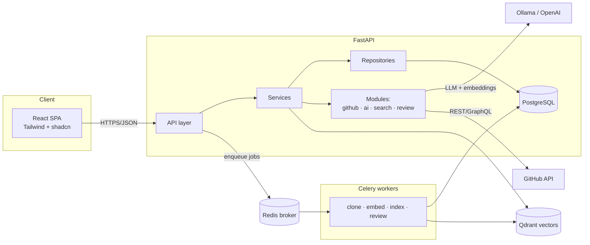

<div align="center">

# ReviewIQ

**AI code review that reads pull requests like a senior engineer.**

Indexes your repository, understands each diff with retrieval-augmented generation,
and posts scored, severity-tagged feedback — bugs, security, performance, and
maintainability — with explanations and suggested fixes.

`FastAPI` · `Celery` · `Redis` · `PostgreSQL` · `Qdrant` · `React` · `TypeScript` · `Tailwind` · `Docker`

</div>

---

## The problem

Developers spend a large share of their week reviewing pull requests, and a lot of
what they catch is mechanical: a value that can be `None`, a query built with string
concatenation, a duplicated block, a missing edge case. ReviewIQ catches that class of
issue automatically **before** a human reviewer looks, so people spend their attention
on architecture and intent — while code quality goes *up*, not down.

## What it does

- **GitHub integration** — OAuth login, connect repos, read PRs / commits / diffs.
- **Repository indexing** — clone, chunk source files, embed, and store vectors in Qdrant.
- **PR analysis** — for every changed file: understand context, then detect bug risks,
  security issues (SQLi/XSS/insecure APIs), code smells, performance problems, duplication,
  and missing edge cases.
- **Scored review** — Code Quality, Complexity, Security, Maintainability, Performance
  (0–100) plus an executive summary and per-finding severity (Low → Critical).
- **Ask AI** — “Explain this change”, “What tests should I write?”, “Review only security”.
- **Semantic search** — “Where is JWT implemented?”, “Find the DB connection”.

## Architecture

Clean Architecture: the API layer depends on services, services on repositories and the
domain, and heavy work runs off-request in Celery workers.



See [`docs/architecture.md`](docs/architecture.md) for the request/worker lifecycle and
[`docs/folder-structure.md`](docs/folder-structure.md) for the annotated tree.

## Tech stack & why

| Area          | Choice                              | One-line rationale                                             |
| ------------- | ----------------------------------- | -------------------------------------------------------------- |
| API           | **FastAPI + Pydantic**              | Async, typed, auto OpenAPI docs — ideal for an I/O-bound AI app |
| Workers       | **Celery + Redis**                  | Reviews/embeddings are long tasks; keep requests fast          |
| Database      | **PostgreSQL + SQLAlchemy**         | Relational integrity for users → repos → PRs → reviews         |
| Vector DB     | **Qdrant**                          | Fast ANN search, runs free in Docker, great filtering          |
| LLM           | **Ollama** (OpenAI-pluggable)       | Local-first = **$0**; swap to OpenAI via one env var           |
| Embeddings    | **BGE/E5** (OpenAI-pluggable)       | Strong open models, free, run on CPU                           |
| Frontend      | **React + TS + Tailwind + shadcn**  | Modern SaaS UI, type-safe, accessible components               |
| Data fetching | **TanStack Query**                  | Caching, retries, loading/error states out of the box          |
| Auth          | **JWT + GitHub OAuth**              | Stateless sessions; GitHub is the identity + data source       |
| Packaging     | **Docker Compose**                  | One command brings up the whole stack                          |

> Full, interview-ready rationale (FastAPI vs Flask, why Postgres/Redis/Qdrant/Celery,
> how RAG works, etc.) lives in `interview-notes/` — a **local-only** folder that is
> gitignored on purpose.

## Repository layout

```
ReviewIQ/
├── backend/          FastAPI app (Clean Architecture) + tests
├── frontend/         React + TypeScript + Tailwind SPA
├── docs/             Architecture, folder structure, API, deployment
├── interview-notes/  LOCAL ONLY — tech rationale + interview prep (gitignored)
├── docker-compose.yml
├── Makefile
└── .env.example
```

## Quickstart

### Option A — local (fastest for development)

```bash
# 1) Backend
cd backend
uv sync
cp ../.env.example ../.env        # then edit secrets
uv run uvicorn app.main:app --reload --port 8000
#   → http://localhost:8000/docs

# 2) Frontend (new terminal)
cd frontend
npm install
npm run dev
#   → http://localhost:5173
```

Or from the repo root: `make install` then `make dev-api` / `make dev-web`.

### Option B — full stack with Docker

```bash
cp .env.example .env
make up        # Postgres + Redis + Qdrant + API
make logs
```


## License

Personal portfolio project — no formal open-source license (all rights reserved).
Feel free to explore the code; reach out if you'd like to reuse any of it.
