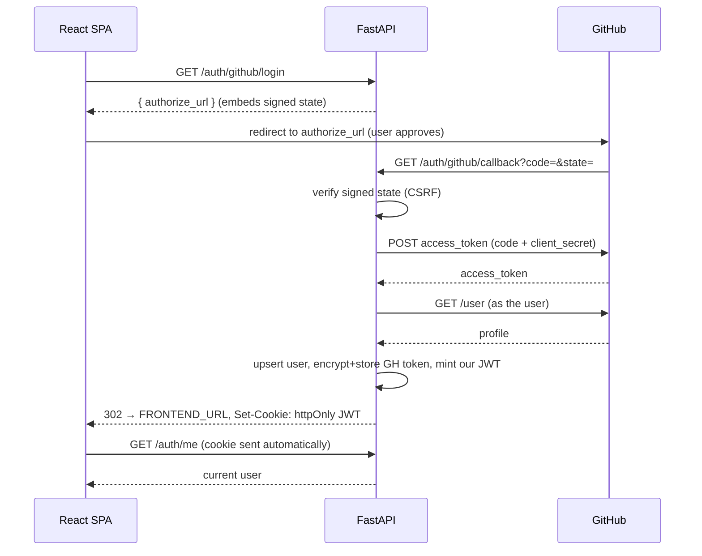

# Phase 2 — Authentication (JWT + GitHub OAuth)

> Status: ✅ complete. The front door: "Sign in with GitHub" → a ReviewIQ session.

## What shipped

- **GitHub OAuth (authorization-code) flow** — `app/modules/auth/github.py` isolates
  every GitHub HTTP call behind an injectable client (testable, one place for
  rate-limit/error handling).
- **Security primitives** — `app/modules/auth/security.py`: JWT issue/verify (HS256),
  Fernet **encryption of the GitHub token at rest**, and a signed **OAuth state** token
  (stateless CSRF protection).
- **Service + repository** — `AuthService.complete_login()` orchestrates the flow;
  `UserRepository.upsert_from_github()` keys on GitHub's numeric id so a username change
  never duplicates an account.
- **`get_current_user` dependency** — accepts the JWT from an **httpOnly cookie**
  (browser) *or* `Authorization: Bearer` (API clients); guards routes with a clean 401.
- **Routes** (`/api/v1/auth`): `GET /github/login`, `GET /github/callback`,
  `GET /me`, `POST /logout`.
- **Frontend** — a real "Sign in with GitHub" control (TanStack Query for `/me`,
  graceful handling when OAuth isn't configured).

**Verification:** `ruff` + `mypy` clean; **29/29** unit tests (JWT/encryption/state,
401s, GitHub client via `httpx.MockTransport`); a full **end-to-end run against real
Postgres** (mocked GitHub): callback → user upsert → token encrypted at rest → JWT →
`GET /me` succeeds via both Bearer and cookie, and the token never leaks to the client.

## The OAuth flow



## Try it (needs a GitHub OAuth App)

1. Create an OAuth App: https://github.com/settings/developers →
   - Homepage: `http://localhost:5173`
   - Callback: `http://localhost:8000/api/v1/auth/github/callback`
2. Put the credentials in `.env`:
   ```bash
   GITHUB_CLIENT_ID=...
   GITHUB_CLIENT_SECRET=...
   ```
3. Restart the API (`make dev-api`), open the SPA, click **Sign in with GitHub**.

Without those credentials, `/auth/github/login` returns **503** and the SPA shows a clear
"OAuth not configured" message — the flow is wired, it just needs your app.

## Security notes (design choices)
- **JWT in an httpOnly cookie** → JavaScript (and thus XSS) can't read the token.
  In dev it's `SameSite=Lax` over plain HTTP; in prod set `COOKIE_SECURE=true` and, if the
  SPA and API are on different sites, `COOKIE_SAMESITE=none`.
- **GitHub token encrypted at rest** with Fernet — a DB leak doesn't expose repo access.
- **Signed OAuth state** defeats CSRF on the callback with zero server-side storage.
- **`UserOut` schema has no token field** — credentials can't accidentally serialize out.
