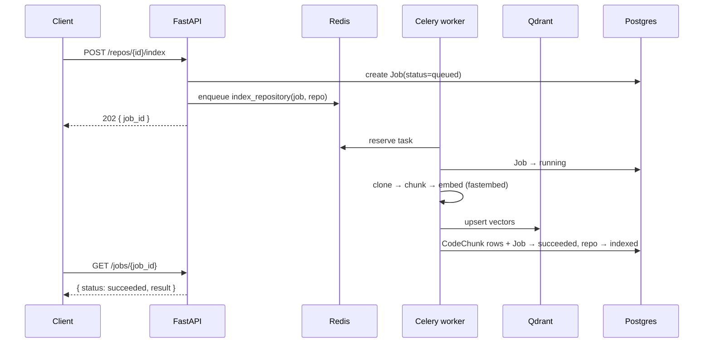

# Phase 4 — Indexing pipeline (clone → chunk → embed → Qdrant, via Celery)

> Status: ✅ complete. Turns a connected repository into a searchable vector index —
> the retrieval foundation for semantic search (Phase 5) and the review engine (Phase 6).

## What shipped

- **Background workers** — a Celery app on **Redis** (`app/workers/`). The API enqueues a
  job and returns `202` immediately; a worker does the heavy lifting off-request.
- **Local embeddings** — `app/modules/ai/embeddings.py`: an `EmbeddingProvider` interface
  with a **fastembed** (BGE-small, ONNX, CPU, `$0`) implementation, lazily loaded. OpenAI
  is a pluggable swap.
- **Qdrant vector store** — `app/modules/search/vector_store.py`: ensure-collection,
  upsert, per-repo delete/count, cosine distance.
- **Cloner + chunker** — `app/modules/indexing/`: shallow `git clone --depth 1`, then a
  line-window chunker (with overlap) that skips non-source/oversized/vendored files.
- **Indexing service** — clone → walk files → chunk → embed in batches → upsert vectors to
  Qdrant + chunk metadata to Postgres → mark the repo `INDEXED`.
- **Job tracking** — `Job` rows move `QUEUED → RUNNING → SUCCEEDED/FAILED` with progress
  and results.
- **Endpoints**: `POST /api/v1/repos/{id}/index` (202 + job) and `GET /api/v1/jobs/{id}`
  (poll status), both auth-gated and ownership-checked.

**Verification:** `ruff` + `mypy` clean; **47/47** tests (incl. chunker windowing/overlap,
file filtering, and auth-gating on the new routes). A full **end-to-end run against real
Redis/Qdrant/Postgres**: a local git repo was cloned, indexed (3 files → 3 chunks),
embedded with real fastembed, and **Qdrant vector count == Postgres CodeChunk count**,
with the job `SUCCEEDED` and the repo `INDEXED`.

## The async flow



## Run it
```bash
# infra
docker compose up -d db redis qdrant
cd backend && uv run alembic upgrade head

# worker (terminal 1)
uv run celery -A app.workers.celery_app worker --loglevel=info
# api (terminal 2)
uv run uvicorn app.main:app --reload --port 8000
```
Then (once logged in) `POST /repos/{id}/index` and poll `GET /jobs/{id}`. Or run the whole
stack — worker included — with `docker compose up -d --build`.

## Design choices
- **Shallow clone** (`--depth 1`): indexing needs the current tree, not history — far faster.
- **fastembed over sentence-transformers**: no torch/GPU, tiny footprint, same BGE quality —
  perfect for local `$0`. Provider interface keeps OpenAI one env var away.
- **Vectors in Qdrant, metadata in Postgres**: ANN search where it belongs; `vector_id`
  links a chunk row to its point. Chunk text is duplicated into the Qdrant payload so search
  can return snippets without a DB round-trip.
- **`content_hash` per chunk** is stored now to enable **incremental re-indexing** later
  (skip unchanged chunks); Phase 4 does a full re-index for correctness.
- **Token safety**: the clone URL embeds the user's token only for the ephemeral clone dir,
  which is deleted in a `finally`; tokens are scrubbed from any error output.
