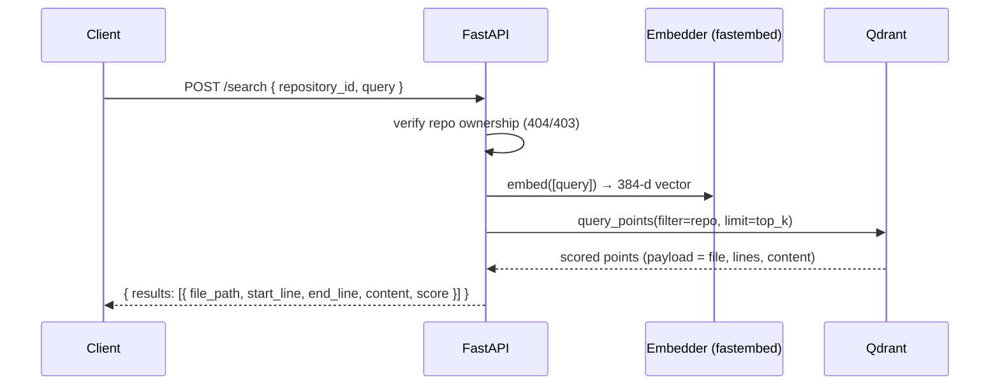

# Phase 5 — Semantic search (natural-language code search over the Qdrant index)

> Status: ✅ complete. Adds the *query* side of retrieval: the same embedding model that
> indexed a repo now embeds a natural-language question and returns the nearest code chunks —
> the retrieval the review engine (Phase 6) and Ask-AI (Phase 7) build on.

## What shipped

- **Vector search primitive** — `app/modules/search/vector_store.py`: a new `search()` on
  `QdrantVectorStore` runs a cosine `query_points` scoped to one repository (reusing the same
  `_repo_filter` as deletes) and reconstructs each hit into a payload-only `SearchHit`
  dataclass — no Qdrant types leak past this layer. Returns `[]` (never raises) when the repo
  hasn't been indexed yet.
- **Search service** — `app/modules/search/service.py`: `SearchService(db, user)` enforces repo
  ownership (404/403, existence hidden from non-owners), embeds the query via the shared
  `EmbeddingProvider`, and returns ranked hits. `SEARCH_TOP_K` (default 10) is the fallback limit.
- **Endpoint** — `app/modules/search/router.py`, wired at `POST /api/v1/search`, auth-gated,
  with a clean request/response boundary (`schemas.py`).
- **Config** — `SEARCH_TOP_K` added to `app/core/config.py`; per-request `limit` override is
  bounded 1–50 in the schema.
- **Search UI** — `frontend/src/App.tsx`: a repo selector + query box that calls the endpoint
  (`lib/api.ts: searchCode`) and renders ranked results — file path, line range, a similarity
  score, and the matching snippet. The roadmap advanced to Phase 5.

**Endpoints**

| Method | Path              | Purpose                                                        |
| ------ | ----------------- | -------------------------------------------------------------- |
| POST   | `/api/v1/search`  | Rank code chunks in one repo by semantic similarity to a query |

**Verification:** `ruff` + `mypy` clean (66 source files); **51/51** backend tests, incl. the
new vector-store `search` unit tests (a fake `AsyncQdrantClient` asserts the payload→`SearchHit`
mapping, that the query is repo-scoped, and the empty-collection short-circuit) and route
auth-gating (401 unauthenticated, 422 on a blank query). Frontend `oxlint` clean and
`tsc -b && vite build` green; the SPA renders the new search panel and advances the roadmap to
Phase 5 (logged-out it degrades to a "sign in" hint). A live query against real Qdrant is the
manual smoke test in **Run it** below — it needs an OAuth login + an indexed repo, so it isn't
part of the hermetic suite.

## The search flow



## Run it
```bash
# infra + a freshly indexed repo (see Phase 4)
docker compose up -d db redis qdrant
cd backend && uv run alembic upgrade head
uv run uvicorn app.main:app --reload --port 8000   # + a Celery worker to index a repo

# then, once logged in and a repo is INDEXED, from Swagger /docs or curl:
#   POST /api/v1/search  { "repository_id": "<uuid>", "query": "where is JWT auth?" }
```
Frontend: `cd frontend && npm run dev`, sign in, pick the indexed repo, and search. Backend
unit tests only (no infra): `cd backend && uv run pytest -q`.

## Design choices
- **`query_points` over the removed `search`**: qdrant-client 1.18 dropped `Async…​.search`;
  `query_points` is the supported path and returns the same scored points.
- **Reuse `_repo_filter` for scoping**: the exact filter used for per-repo deletes now scopes
  reads too, so a user can only ever retrieve their own code — the tenant boundary lives in one
  place instead of being re-derived per call.
- **`SearchHit` dataclass at the store boundary**: the router/service never import Qdrant types;
  the payload shape stays owned by `vector_store.py`, mirroring how `make_point`/upsert already work.
- **Snippets straight from the Qdrant payload** (duplicated at index time in Phase 4): search
  returns code without a second Postgres round-trip.
- **Empty, not error, before first index**: querying a repo whose collection doesn't exist yet
  returns `[]`, so the UI shows a friendly "finish indexing" hint rather than a 500.
- **Same model on both sides**: the query is embedded with the *identical* provider used at index
  time — mismatched embedding spaces would silently wreck relevance.
