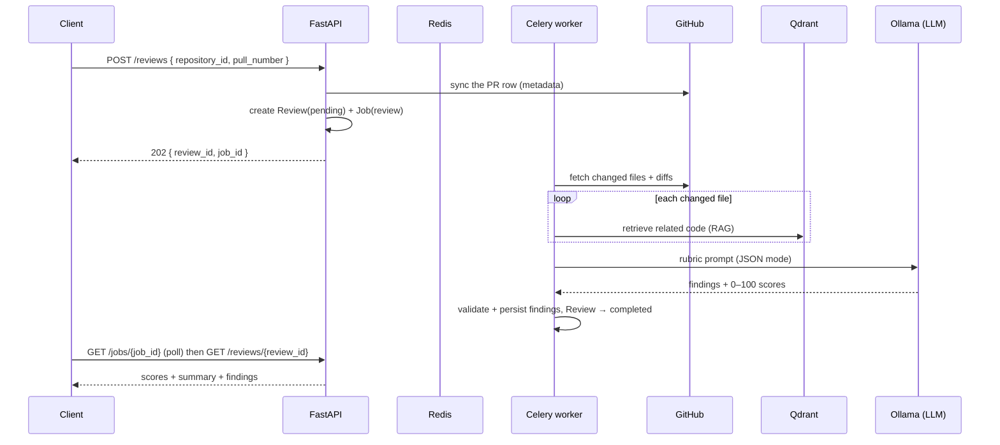

# Phase 6 — Review engine (RAG + LLM → scored findings)

> Status: ✅ complete. This is the product: it turns a pull request's diff into a scored,
> severity-tagged review. It stands on Phase 4's index and Phase 5's retrieval — the same
> vectors, embedded with the same model — and runs off-request like indexing does.

## What shipped

- **LLM provider** — `app/modules/ai/llm.py`: an `LLMProvider` interface with a local
  **Ollama** implementation (`POST /api/chat`, JSON mode, low temperature). Mirrors the
  embeddings provider — OpenAI is a pluggable swap via `AI_PROVIDER`. The `httpx` client is
  injectable so it's testable without a running model.
- **Review service** — `app/modules/review/service.py`: for each changed file it retrieves
  related code from Qdrant (RAG, reusing Phase 5's `vector_store.search`), builds a rubric
  prompt (`prompt.py`), asks the LLM for structured JSON, and validates it. Findings are
  parsed **one-by-one** so a single malformed entry never sinks the whole review.
- **Structured output** — `schemas.py`: `LLMReviewResult`/`LLMFinding` validate the model's
  JSON, normalising enum case and clamping scores/confidence into range. The API boundary
  (`ReviewRequest`, `ReviewOut`, `FindingOut`) is separate.
- **Persistence** — `review_repository.py` + `finding_repository.py`: a `Review` moves
  `PENDING → RUNNING → COMPLETED/FAILED` and holds the five 0–100 scores, summary, and
  provider/model provenance; `Finding`s are bulk-inserted.
- **Background job** — `app/workers/`: `review_pull_request_task` → `run_review_job` (a
  clone of the indexing runner's dedicated-`NullPool`-engine pattern), running as the repo
  **owner** so their token fetches the diff.
- **Endpoints**

  | Method | Path | Purpose |
  | ------ | ---- | ------- |
  | POST | `/api/v1/reviews` | Create a review + enqueue the job (202 → `{review_id, job_id}`) |
  | GET | `/api/v1/reviews/{id}` | The review with scores, summary, and findings (ownership-checked) |

- **Frontend** — `App.tsx`: a `ReviewCard` (repo + PR number → trigger → poll the job →
  render scores + findings). Roadmap advanced to Phase 6.

**Verification:** `ruff` + `mypy` clean (73 source files); **62/62** tests, incl. the LLM
client over `httpx.MockTransport` (JSON-mode request shape, error + empty-response paths),
the parsing/validation logic (score clamping, enum-case normalisation, malformed-finding
skipping, non-JSON rejection), the prompt builder, and route auth-gating (401 + 422). The
frontend `oxlint`s and builds clean and renders the review panel + Phase-6 roadmap. A **live**
review against real Ollama is the manual smoke test in **Run it** — it needs Ollama installed
and an indexed repo with an open PR, so it isn't part of the hermetic suite.

## The review flow



## Run it
```bash
# infra + a local LLM
docker compose up -d db redis qdrant
ollama serve & ollama pull qwen2.5-coder:7b      # local, $0
cd backend && uv run alembic upgrade head        # no new migration in P6

# api + worker (separate terminals)
uv run uvicorn app.main:app --reload --port 8000
uv run celery -A app.workers.celery_app worker --loglevel=info
```
Once logged in, with a repo **indexed** (Phase 4) and a PR open: `POST /api/v1/reviews`
`{repository_id, pull_number}`, poll `GET /jobs/{id}`, then `GET /reviews/{review_id}`. Or
use the review panel in the SPA. Hermetic tests (no infra/LLM): `uv run pytest -q`.

## Design choices
- **LLM behind an interface, JSON mode on**: no vendor lock-in, and constraining the model
  to JSON + validating with Pydantic turns a flaky text generator into a typed contract.
- **Tolerant parsing**: scores are clamped and enum case normalised; a bad finding is skipped,
  not fatal. Local models drift — the review should degrade, not crash.
- **Reuse retrieval, don't reinvent it**: the review embeds each diff with the *same* model
  and queries the *same* Qdrant collection as search — one retrieval path, and it's already
  tested.
- **Runs as the repo owner in a worker**: reviews take seconds–minutes on CPU; the API returns
  202 instantly, and the worker uses the owner's token (like indexing) to read the diff.
- **Bounded work**: `REVIEW_MAX_FILES`, `REVIEW_MAX_PATCH_CHARS`, and `REVIEW_CONTEXT_TOP_K`
  cap the prompt size (and cost) so one huge PR can't blow up the context window.
- **`review_id` returned up front** (not just a job id) so the client can fetch the result the
  moment the job succeeds, without decoding the job payload.
