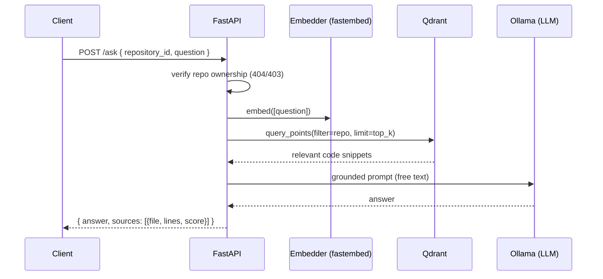

# Phase 7 — Ask-AI (conversational Q&A grounded in the repo)

> Status: ✅ complete. Natural-language questions about a codebase — "what tests should I
> write for auth?", "where is the DB configured?" — answered from the indexed code. It's a
> thin composition of Phase 5 retrieval and the Phase 6 LLM provider, and runs synchronously.

## What shipped

- **Free-text LLM method** — `app/modules/ai/llm.py`: added `generate_text` alongside
  `generate_json` (a shared `_chat(..., json_mode)` — JSON mode off for prose). The
  `LLMProvider` interface now covers both structured and conversational output.
- **Ask service** — `app/modules/ask/service.py`: `AskService` deliberately reuses
  `SearchService` for ownership + embedding + Qdrant retrieval, then feeds the retrieved
  snippets + question to the LLM. ~15 lines of real logic — no new retrieval or auth code.
- **Grounded prompt** — `app/modules/ask/prompt.py`: instructs the model to answer **only**
  from the provided code and to say "I don't have enough information" rather than hallucinate.
- **Endpoint**

  | Method | Path | Purpose |
  | ------ | ---- | ------- |
  | POST | `/api/v1/ask` | Answer a question about a repo, with the source snippets it used |

  Synchronous (one LLM call) — unlike the batch review — with `answer` + cited `sources`.
- **Config** — `ASK_CONTEXT_TOP_K` (default 6): more grounding context than a per-file review.
- **Frontend** — `App.tsx`: an `AskCard` (repo + question → answer + "grounded in" source
  chips). Roadmap advanced to Phase 7.

**Verification:** `ruff` + `mypy` clean (77 source files); **68/68** tests, incl. a fake-backed
`AskService` test (asserts retrieve→prompt→LLM wiring and that `top_k`/the question flow
through), the grounded-prompt builder, the free-text LLM path over `httpx.MockTransport`
(asserts JSON mode is *off*), and route auth-gating (401 + 422). Frontend `oxlint` + build
clean; the SPA renders the Ask panel and advances the roadmap to Phase 7. A **live** answer
needs Ollama + an indexed repo (the manual smoke test in **Run it**).

## The Ask flow



## Run it
```bash
docker compose up -d db redis qdrant
ollama serve & ollama pull qwen2.5-coder:7b
cd backend && uv run alembic upgrade head       # no new migration in P7
uv run uvicorn app.main:app --reload --port 8000
```
Once logged in with a repo **indexed** (Phase 4): `POST /api/v1/ask`
`{repository_id, question}`, or use the Ask panel in the SPA. Hermetic tests (no infra/LLM):
`cd backend && uv run pytest -q`.

## Design choices
- **Compose, don't duplicate**: Ask is `SearchService` (retrieval + ownership) + `LLMProvider`
  (answer). Reusing the tested retrieval path meant almost no new surface area to get wrong.
- **Synchronous, not a job**: a single LLM call for an interactive Q&A — polling would hurt the
  UX. (Reviews stay async because they're a batch over many files.)
- **Grounded + honest**: the prompt forbids answering beyond the retrieved context and returns
  the exact snippets used as `sources`, so answers are auditable, not black-box.
- **`generate_text` vs `generate_json`**: one provider, two shapes — structured JSON for reviews,
  free prose for chat — sharing a single HTTP path.
- **More context than review** (`ASK_CONTEXT_TOP_K=6`): a broad question benefits from wider
  recall; a per-file review wants tight, file-local context.
