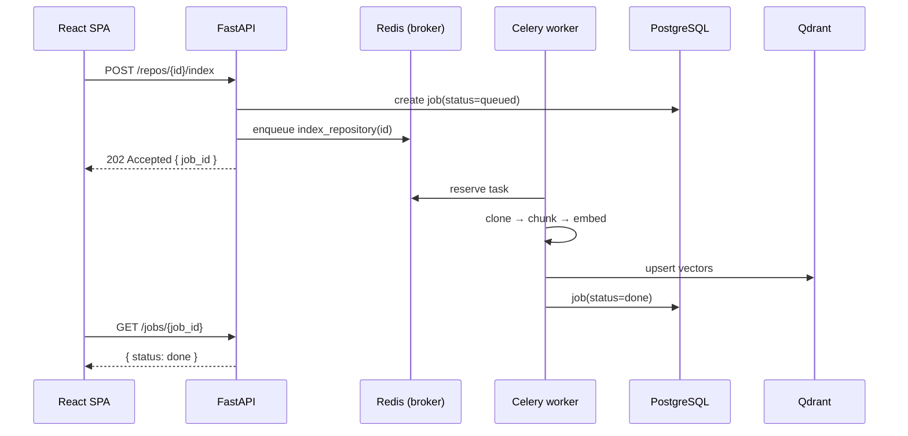

# Architecture

ReviewIQ follows **Clean Architecture**: dependencies point inward. The web
framework, database, GitHub, and the LLM are all *details* at the edges; the
domain logic in the middle does not import them directly. This keeps the core
testable and lets us swap infrastructure (Ollama ↔ OpenAI, Qdrant ↔ another
vector DB) without rewriting business logic.

## Layers

```
            ┌──────────────────────────────────────────────┐
 inbound →  │  API  (FastAPI routers, request/response DTOs) │
            ├──────────────────────────────────────────────┤
            │  Services  (use-cases / orchestration)         │
            ├──────────────────────────────────────────────┤
            │  Domain  (entities, value objects, rules)      │
            ├──────────────────────────────────────────────┤
            │  Repositories  (data access over SQLAlchemy)   │
            └──────────────────────────────────────────────┘
             Modules (github · ai · search · review) plug into Services
             Workers (Celery) run the same Services off-request
```

| Layer            | Knows about…                    | Must NOT know about…              |
| ---------------- | ------------------------------- | --------------------------------- |
| **API**          | Services, schemas               | SQLAlchemy models, HTTP of GitHub |
| **Services**     | Domain, repositories, modules   | FastAPI request objects           |
| **Domain**       | Nothing external                | DB, web, network                  |
| **Repositories** | DB models + session             | HTTP, business rules              |

### Why the split matters (interview soundbite)
> "A route handler should read like a table of contents: authenticate, call one
> service method, return a DTO. All the interesting logic lives in services and is
> unit-testable without spinning up FastAPI."

## Request lifecycle (synchronous path)

1. Request hits a **FastAPI router** → Pydantic validates the input.
2. A **dependency** resolves the current user (JWT) and a DB session.
3. The router calls a **service** method (the use-case).
4. The service uses **repositories** (DB) and **modules** (GitHub/AI/search) to do work.
5. The service returns a **domain object**; the router serializes it to a **response schema**.

## Asynchronous path (the heavy lifting)

Cloning a repo, generating embeddings, indexing, and running an AI review can each
take seconds to minutes. Doing that inside a request would block a worker and time
out the client. Instead:

1. The API **enqueues a job** (e.g. `index_repository(repo_id)`) onto **Redis**.
2. A **Celery worker** picks it up and runs the same service code.
3. Progress + results are written to **PostgreSQL** (a `jobs` row) and, for vectors, **Qdrant**.
4. The frontend **polls** the job status (or, later, subscribes via SSE/WebSocket).



## The AI review pipeline (Phase 6 preview)

1. **Retrieve** — for a changed file/hunk, embed it and query Qdrant for the most
   relevant existing code (definitions, callers, similar patterns). This is the
   *retrieval* in RAG and gives the model repo-specific context.
2. **Augment** — build a prompt: the diff + retrieved context + a strict rubric.
3. **Generate** — the LLM returns structured findings (JSON) validated by Pydantic:
   `{ line, severity, category, why, impact, suggested_fix }`.
4. **Score** — aggregate findings into Quality/Security/Complexity/etc. scores.

## Component boundaries

- `modules/ai` exposes `LLMProvider` and `EmbeddingProvider` **interfaces**. Ollama and
  OpenAI are implementations chosen at runtime by config — the review engine never imports
  a vendor SDK directly.
- `modules/github` wraps REST + GraphQL behind one typed client, so rate-limiting and auth
  live in one place.

_ER diagram and table designs are added in Phase 1 (`docs/er-diagram.md`)._
