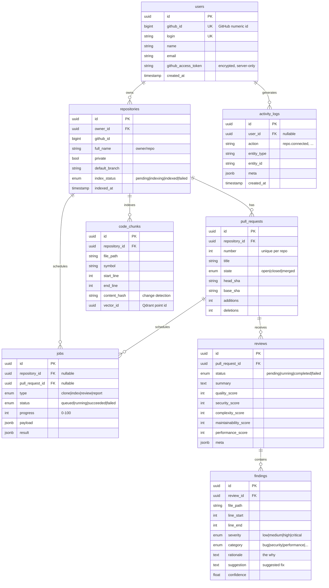

# Entity–Relationship diagram

The relational core of ReviewIQ. One user connects many repositories; each repo has
many pull requests; each PR gets one or more reviews; each review produces many
findings. Repositories also own their indexed code chunks and background jobs.

## Cardinality & delete rules

| Relationship | Cardinality | On delete |
| --- | --- | --- |
| user → repositories | 1 : N | CASCADE (removing a user removes their repos + everything under them) |
| repository → pull_requests | 1 : N | CASCADE |
| pull_request → reviews | 1 : N | CASCADE |
| review → findings | 1 : N | CASCADE |
| repository → code_chunks | 1 : N | CASCADE (re-index replaces them) |
| repository / pull_request → jobs | 1 : N | CASCADE |
| user → activity_logs | 1 : N | SET NULL (keep the audit trail even if the user is deleted) |

## Notes on design choices

- **UUID primary keys** everywhere — no leaked counts, safe to generate app-side.
- **Native PostgreSQL enums** (`index_status`, `pr_state`, `review_status`, `severity`,
  `finding_category`, `job_type`, `job_status`) give DB-level validation.
- **JSONB** columns (`reviews.meta`, `jobs.payload/result`, `activity_logs.meta`) hold
  flexible, semi-structured data while staying queryable/indexable.
- **`code_chunks.vector_id`** links a relational row to its vector in Qdrant; the float
  vectors themselves live in Qdrant, not Postgres.
- **`content_hash`** enables skipping re-embedding of unchanged code — the biggest cost
  lever in the indexing pipeline.
- **Indexes** on every foreign key and on hot filter columns (`state`, `severity`,
  `category`, `index_status`, `content_hash`, `celery_task_id`).
